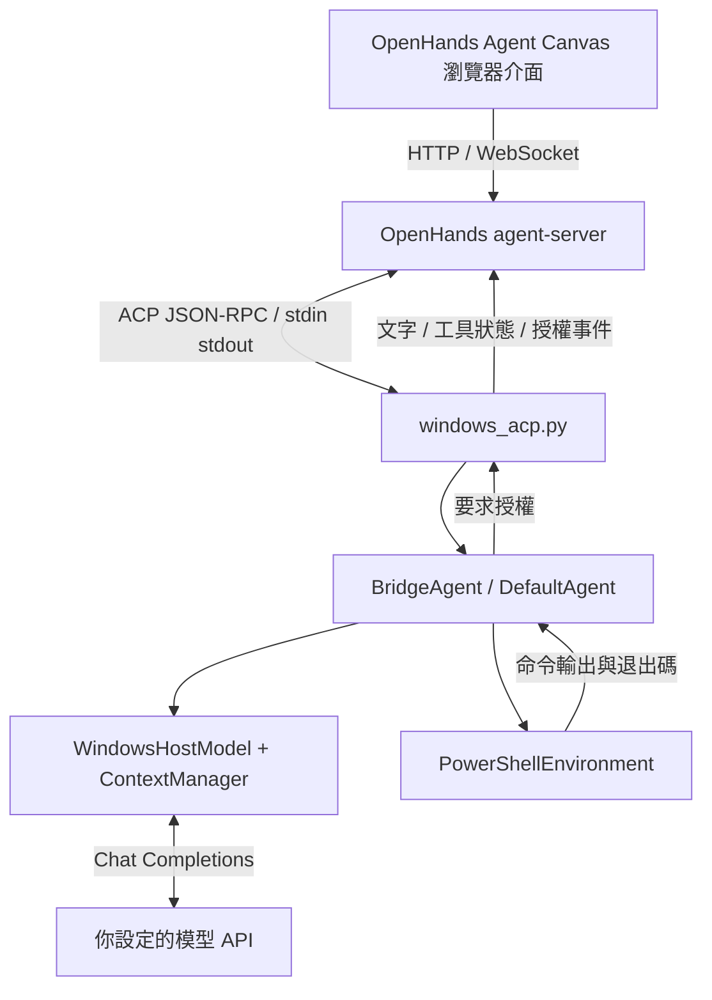

# Oh My PiPy (OMPy)

**Oh My PiPy（簡稱 OMPy）是模改自 [mini-swe-agent](https://github.com/SWE-agent/mini-swe-agent) 的通用 AI agent。** 保留 mini-swe-agent 精簡的模型／工具迴圈，加入 Windows PowerShell 執行、OpenHands WebUI、背景上下文壓縮與專案內一鍵安裝。

Windows 專案內的通用 AI 助理，可協助程式開發、資料分析、文件處理、研究與自動化等任務。以 **OpenHands Agent Canvas** 作為 WebUI，透過 **ACP stdio** 啟動此份 mini-swe 原始碼；模型與 PowerShell 工具迴圈由 mini-swe 執行。

核心引擎、預設提示詞、工具與 UI 都不綁定特定領域。`experiments/` 中的鑑識資料只用於長上下文實驗，不載入核心引擎；這類案例的完成結果也不構成圖靈完備性的證明。

## 一鍵啟動

1. 下載這份專案並解壓縮，或從自己的 GitHub repository clone 下來。
2. 雙擊 **`start.cmd`**。
3. 第一次依提示輸入模型 API 網址、模型名稱及 API key；亦可事先複製 `.env.example` 為 `.env` 並填好。
4. 瀏覽器會開啟 `http://127.0.0.1:8000/canvas`，自動接到 `OMPy`，直接開始對話。啟動器每次都套用這個預設，不需要在 OpenHands 選 agent、LLM 或供應商；模型沿用專案 `.env`。

首次執行需要網路下載依賴。無須事先安裝 Node.js、Python、uv 或 mini-swe；不需要管理員權限。關閉啟動視窗／按 Ctrl+C 可停止服務。

下載或 clone 後，在專案目錄用一個命令安裝並啟動：

```powershell
powershell.exe -NoProfile -ExecutionPolicy Bypass -File .\install.ps1
```

已有 API 配置會直接沿用。指定另一組模型 API 時，替換以下範例網址與模型名稱；API key 會以隱藏輸入詢問，不要把真實 key 寫在命令列或 README：

```powershell
powershell.exe -NoProfile -ExecutionPolicy Bypass -File .\install.ps1 -ApiBaseUrl "https://api.example.com/v1" -Model "your-tool-capable-model"

# 本機服務不需要驗證時，明確使用 LocalApi
powershell.exe -NoProfile -ExecutionPolicy Bypass -File .\install.ps1 -ApiBaseUrl "http://127.0.0.1:11434/v1" -Model "your-local-model" -LocalApi

# 只重新設定 API 與建置環境，不啟動 UI
powershell.exe -NoProfile -ExecutionPolicy Bypass -File .\install.ps1 -ConfigureApi -SetupOnly
```

這裡的 API 是 **mini-swe 使用的模型推論 API**：base URL 下的 `/chat/completions`，需支援 function tools 與目前轉接器的 `max_completion_tokens`、`reasoning_effort` 參數。可設定遠端服務或自己的推論主機。設定存在未提交的 `.env`；若已有舊版 `mini-swe-agent/.env`，會沿用它作為更新目標，保留其他參數。未要求重新設定時不改寫現有檔案。`HARNESS_*` 環境變數仍有優先權，亦可用環境變數提供 key。

切換到不同 API 主機時會要求該主機的 key，不會默默沿用舊 key；無驗證服務需明確指定 `-LocalApi`。非互動安裝請透過 `HARNESS_API_KEY` 提供 key。

## 從 GitHub 一次貼上安裝

以下命令可直接貼到 Windows PowerShell，不需要 Git；`Destination` 可指定安裝位置。首次啟動會詢問你的模型 API 網址、模型名稱與 key。

```powershell
& {
    [Net.ServicePointManager]::SecurityProtocol = [Net.SecurityProtocolType]::Tls12
    $repo = 'https://github.com/aaaddress1/OMPy'
    $ref = 'main'
    $installer = ($repo -replace '^https://github.com/', 'https://raw.githubusercontent.com/') + "/$ref/install.ps1"
    & ([scriptblock]::Create((Invoke-WebRequest -UseBasicParsing -Uri $installer).Content)) `
        -RepositoryUrl $repo -Ref $ref -Destination (Join-Path $PWD 'OMPy')
}
```

安裝器只接受 HTTPS GitHub repository 網址，下載指定 branch、tag 或 commit 的來源 ZIP，在指定目錄內建置；目的地有既有專案時重用，有其他檔案時拒絕覆寫。下載暫存保存在專案的 `.bootstrap/`，不納入 Git 或來源包。使用你信任的 repository；要固定來源版本，可將 `$ref` 換成 commit SHA。

目前以 Windows x64 驗證；安裝器也會選取 ARM64 runtime，但 ARM64 尚未實機測試。模型推論服務需另行提供，本專案不打包模型權重。

```powershell
# 只建置環境，不啟動 UI，也不要求輸入 API key
.\start-canvas.ps1 -SetupOnly

# 不自動開瀏覽器
.\start-canvas.ps1 -NoBrowser

# 調整對外入口連接埠
.\start-canvas.ps1 -Port 8008
```

安裝器固定 Node、uv、Python 和 OpenHands 的版本；Node／uv 下載會比對 SHA256，mini-swe 的 Windows runtime 與 Canvas 前端依賴使用 lock 檔。一般重新啟動會重用已建好的環境。

若舊版 UI 還在執行，未指定連接埠時會自動選擇空閒的入口與內部連接埠，不會停止舊版服務；實際網址會顯示在啟動視窗。

## Console UI

雙擊 **`start-console.cmd`**，或在專案目錄執行：

```powershell
.\start-console.cmd
# 首次安裝也可以直接選終端模式
powershell.exe -NoProfile -ExecutionPolicy Bypass -File .\install.ps1 -Console
```

終端介面參考 [Oh My Pi](https://github.com/can1357/oh-my-pi) 的對話、工具卡片與底部狀態列，使用 Rich 和 prompt-toolkit 實作。沿用同一組 `.env`、模型轉接器與四層上下文管理，不需要選供應商；終端模式只準備專案內 Python 環境，不下載 Node 或 OpenHands WebUI。

- 回覆即時串流，支援 Markdown 與程式碼配色。思考區只顯示模型實際回傳的推理欄位，可收起；未回傳時不補造內容。
- 工具結果預設六行，可用 `/last` 展開完整的上一個工具輸出。錯誤退出碼、記憶操作與背景摘要會分別顯示。
- 輸入編輯器支援多行貼上、Alt+Enter 換行、Enter 送出、Tab 指令補全和方向鍵歷史；提示列顯示模型上下文用量、輸出 tokens 與推理設定。
- `/help` 查看指令；`/thoughts` 切換思考顯示，`/tools` 切換工具預覽，`/new` 新對話，`/exit` 或空輸入時 Ctrl+D 離開。Ctrl+C 中止目前輸入或執行。

需要輸出轉存時，先載入 `scripts/project-env.ps1`，再使用專案的 `.tools/agent-env/Scripts/python.exe -m minisweagent.run.windows_console --plain`。`scripts/preview_console.py` 可產生純合成內容的 SVG／HTML 預覽，不載入 API key 或呼叫模型。WebUI 仍由 `start.cmd` 啟動。

## 所有專案資料放在哪裡

| 位置 | 用途 | 提交 GitHub |
| --- | --- | --- |
| `mini-swe-agent/src/` | 此專案實際執行的 agent 原始碼 | 是 |
| `config/` | runtime 版本及依賴 lock 檔 | 是 |
| `scripts/`、`install.ps1`、`start.cmd`、`start-canvas.ps1` | 建置、設定、啟動及打包 | 是 |
| `.tools/` | Node、uv、Python、虛擬環境、Canvas、套件快取 | 否 |
| `.runtime/openhands/` | UI 設定、agent profiles、對話紀錄及 UI 金鑰 | 否 |
| `mini-swe-agent/.config/` | mini-swe 專案設定 | 否 |
| `mini-swe-agent/.runs/` | 模型請求、命令完整輸出、執行軌跡、上下文摘要、memory 筆記 | 否 |
| `.env` | 模型網址、名稱、API key | 否 |
| `.bootstrap/` | GitHub 安裝器的來源 ZIP 與解壓暫存 | 否 |

安裝不會修改使用者或系統的 PATH，不會註冊 Python 到 Windows Registry，不會全域安裝 mini-swe 或 OpenHands。環境變數只在啟動程序及其子程序中生效。

搬到新路徑後再執行 `start.cmd`，會重建該位置的 Python 虛擬環境並重新產生 ACP 啟動路徑。建議搬移原始碼後重建環境；不保證整包 runtime 跨機離線執行。對話中的舊檔案絕對路徑不會自動改寫，搬家後請建立新對話。

舊版存於使用者目錄 `.openhands` 的資料不會自動匯入或刪除，新版從專案自己的設定開始。舊的使用者層級 uv 快取也不會被新版使用或刪除。

## mini-swe 如何串到 WebUI



- `start-canvas.ps1` 啟動 OpenHands 的前端、API 後端與 automation 服務。Automation 是 UI 的附帶服務，不是 mini-swe 的工具迴圈。
- `scripts/configure_canvas.py` 按目前專案位置產生 Custom ACP profiles，指向 `.tools/agent-env/Scripts/python.exe -m minisweagent.run.windows_acp`。以 `PYTHONPATH` 載入本專案原始碼，不需要將 mini-swe 安裝到系統 Python。
- `windows_acp.py` 接收 `initialize`、`session/new`、`session/prompt` 與取消請求。每個 session 有自己的模型與上下文；每輪在工作執行緒中建立 `BridgeAgent`。
- `BridgeAgent` 沿用 `DefaultAgent` 的「模型 → 工具 → 模型」迴圈，將 assistant 文字與工具狀態回傳 ACP。命令執行前透過 ACP 要求「允許一次／本次對話都允許／拒絕」。
- `WindowsHostModel` 讀取 `.env` 的 `HARNESS_*`，呼叫 `/v1/chat/completions`，提供 `powershell` function tool；compact 模式另有 `context` 記憶與回查工具。回傳純文字最終答案時結束一輪；工具結果則繼續送回模型。
- `PowerShellEnvironment` 在 Canvas 傳入的工作目錄啟動 Windows 內建 PowerShell 5.1，保存完整輸出並回傳最多 6000 UTF-8 bytes 的頭尾預覽。每次命令以 UTF-8 BOM `.ps1` 執行並保存在 `.runs/`，錯誤以純文字回傳，避免 `EncodedCommand` 的 CLIXML 干擾 UI；執行原則只對該次子程序設定。
- UI 的對話歷史與模型上下文分開保存。mini-swe 目前沒有 ACP session 載入／重啟還原能力；只會在同一執行中保留成功結束的歷次任務。
- WebUI 使用串流回傳文字，以及模型提供的 `reasoning_content`／`reasoning`，後者送到 ACP 的思考區。沒有回傳推理欄位時不會補造內容；`reasoning=none` 通常沒有思考內容，可用 `/reasoning low` 或 `/reasoning high` 切換。思考內容不會重送成模型的對話文字。
- 啟動器會在專案內的 Canvas 載入 `openhands_compat.py`。這是對固定版本 SDK 1.56.0 的小型轉接，將原本只在結束時保存的 ACP thoughts 轉為 UI 的即時 reasoning stream，也在執行執行緒先取得串流遮罩，避免 ACP 回呼跨執行緒讀取 state 而鎖死；升級 SDK 時會要求重新檢查相容性。
- 取消會在下一個串流片段或工具執行前檢查；正在執行的 PowerShell 命令仍需等候完成或逾時。終端機模式保留原本的一次性回覆。

UI 會提供四個 profiles：`OMPy` 為一般使用；`OMPy-append-32k`、`OMPy-sliding-32k`、`OMPy-memory-32k` 為上下文策略實驗，固定 32768 tokens、200 步上限與 low reasoning。一般 profile 使用 `.env` 的視窗設定與 32 步上限。

## 四層上下文管理

一般模式預設 `HARNESS_CONTEXT_POLICY=compact`。`context_store.py` 負責外部證據與筆記，`context_compaction.py` 組裝上下文並排程背景摘要；只使用 Python 標準庫 SQLite，不安裝 Pi、新增框架或修改 `DefaultAgent` 核心迴圈。四層互相配合，先做便宜的整理，再判斷是否需要摘要；設計參考 [Harvard Agent Design I](https://cs2680.seas.harvard.edu/slides/4_agent_design_1.pdf) 的四層分類，以及 Pi Durable 的背景／阻塞雙門檻概念。

| 層 | 預設處理 |
| --- | --- |
| Admission | 工具輸出進入視窗前限制預覽大小、保留頭尾；原始 user 任務保持原文，工具 schema 一起計入預算。 |
| Offloading | 原始事件、完整工具輸出與具來源的 keyed notes 保存在 session 的 `context-*.sqlite3`；視窗只帶有限預覽、筆記和回查 ref。 |
| Transformation | 最近四個工具觀察保留較大預覽，較早觀察縮為短預覽；完全相同的舊結果遮蔽為 ref。保留呼叫／結果配對，不將不同輸出擅自視為同一狀態。 |
| Compaction | 整理後仍達門檻，才以背景摘要替換較早歷史。獨立筆記不經過摘要重寫，system prefix 不放入摘要內容。 |

`context` 工具提供 `search`、`read`、`remember`、`forget`。搜尋是本機 literal AND 搜尋，每頁最多六個片段；回讀最多 4000 字元並提供下一頁 offset。ref 只指向該 session 資料庫中的事件／輸出，不能用它讀任意檔案。PowerShell 工具仍走原有權限流程；context 只處理本次對話資料，不啟動 shell。

`remember` 必須提供既有 user/tool 的來源 ref，沿用相同 key 即可更新更正，`forget` 移除過時筆記。筆記有獨立容量上限；超限更新會被拒絕，原筆記不變。來源證明資料出處，不代表模型寫下的內容已經驗證；目前使用者更正優先，遇到衝突仍應回查。重要目標、限制、待辦和發現需由主 agent 主動記錄，不宣稱能自動辨識所有重要事實。

- 輸入可用預算是「上下文視窗 − 單次輸出上限 − 1024」。達到預算約 70% 時，背景執行緒以同一模型 API 整理舊紀錄，主流程繼續；達到約 90% 時，下一次請求等待摘要完成。比例設定集中在 `CompactionConfig`。
- 摘要只在下一次模型請求前接入，合併前次摘要並保留近期約 30% 預算的觀察。工具呼叫與結果成組保留，當前任務原文也保留；背景整理期間新增的訊息會接在摘要後面。
- 每個 session 同時只有一個摘要工作；原始事件以不可變 ID 存檔，輸入前綴改變時舊工作失效。`/new` 會切換資料庫及 ref 命名空間；換掉未成功保存的任務後，其摘要不會回流。等待摘要時仍可取消。
- 摘要失敗時保留完整上下文；到阻塞門檻便回報錯誤並停止該輪，不默默裁切歷史。單一任務或最新工具結果本身過大、沒有可壓縮的舊紀錄時，也會回報。
- `.runs/<session>/compaction-*.request.json`、`compaction-*.json` 保存摘要請求、完整回應與用量；`context-summary.json` 保存最近接入的摘要及事件邊界。原始 trajectory、SQLite 證據與工具輸出不刪除。成功的舊任務不再另外累積在記憶體的 `turns` 清單，但目前 mini-swe 任務的原始 trajectory 仍由 agent 保存。

摘要會額外呼叫一次模型，服務端若只能同時處理一個請求，背景工作仍可能與主流程排隊。摘要可能遺漏細節，模型可依原始紀錄路徑回查。這項功能不提供關閉程序後自動續跑或 ACP session 重啟還原。

測試不需要模型 API：包含 60 輪反覆摘要、過時摘要與最新筆記衝突、來源驗證、記憶更新／超限拒絕、忘記／清除隔離、完整工具配對、外存中段證據與分頁回讀，以及實際 PowerShell 和 SDK tool-call 解析。可另產生供人工判讀的離線回放：

```powershell
. ./scripts/project-env.ps1 -ProjectRoot $PWD.Path
& ./.tools/agent-env/Scripts/python.exe scripts/eval_context_recall.py
```

結果在 `.runs/context-review/`：`final-context.json` 是模型實際會看到的組裝內容，`replay.json` 記錄摘要次數與資料庫位置。回放故意提供錯誤／過時摘要，沒有 API 呼叫。這些測試證明儲存、組裝與回查機制，不保證任意模型都會正確記筆記或解決衝突，也不代表已驗證數百小時連續執行。

已有 `.env` 若明確指定其他 `HARNESS_CONTEXT_POLICY`，會保留該設定；設為 `compact` 並重新啟動後即可使用，無須在 UI 選模型。`sliding`、`append`、`memory` 實驗策略維持原來的行為。

## 隱私與發佈檢查

- 啟動器預設停用 Canvas 前端、agent-server 與 automation 的產品遙測。前端注入執行時 opt-out，後端固定 `OH_TELEMETRY_EXPORTER=none`，並清除本啟動程序繼承的遙測傳送 key／endpoint；不影響 `HARNESS_API_KEY`。依賴中的瀏覽器工具與 Hugging Face 遙測也設為停用。
- WebUI 綁定 `127.0.0.1`。模型連線使用執行者自己的配置；分享來源包不會讓其他人取得本機 `.env`。依賴安裝仍需連外，對話、工具輸出及背景摘要仍會送往指定模型 API；遠端服務建議使用 HTTPS。
- `.env`、UI 對話和 `.runs` 紀錄保存在本機，未加密，不要直接分享整個工作資料夾。實驗 `evidence/` 是由 `experiments/forensic_swe/generate.py` 產生的合成樣本；若加入真實資料，需自行確認可公開。
- 發佈掃描檢查實際來源集合／ZIP，也檢查 Git 已追蹤的檔案及 gitlink，阻擋誤追蹤的 `.env`、常見 credential 格式、目前本機 API key、個人絕對路徑、內網 IP 及私有 runtime 路徑。它是自動檢查，不能保證找出所有形式的敏感資訊。

```powershell
.\.tools\agent-env\Scripts\python.exe scripts\check_release.py
.\.tools\agent-env\Scripts\python.exe scripts\package_source.py
.\.tools\agent-env\Scripts\python.exe scripts\check_release.py --zip dist\OMPy-source.zip
```

CI 會檢查遙測停用與發佈 ZIP。設定 API 不會主動測試付費模型；CI 使用假 key，不需要你的真實 API 配置。

## 打包及放上 GitHub

建置環境後執行：

```powershell
.\.tools\agent-env\Scripts\python.exe scripts\package_source.py
```

輸出為 `dist/OMPy-source.zip`，根目錄為 `OMPy/`，包含 mini-swe 的完整原始碼與 MIT 授權，排除 `.env`、本機環境、金鑰、對話／執行紀錄和所有巢狀 `.git`。解壓縮後可直接雙擊 `start.cmd`。

`mini-swe-agent/` 以一般原始碼目錄提交，並非 submodule；clone OMPy 即可取得完整程式。本機舊版工作區若保留了上游 `.git`，遷移時會將它備份到未提交的 `.runtime/upstream-mini-swe.git`，保留上游歷史。另行建立 repository 時，也可使用來源 ZIP 解壓縮後的資料夾，避免誤提交 gitlink。

`.github/workflows/portable.yml` 會在 Windows runner 建立環境、測試可攜設定與工具執行，並產生可下載的來源 ZIP。CI 不需要模型 API key，不會呼叫付費模型。

## 上游來源與授權

- **模改自 [SWE-agent/mini-swe-agent](https://github.com/SWE-agent/mini-swe-agent)**，目前基底版本為 2.4.6。保留 `mini-swe-agent/` 原始碼目錄、`minisweagent` 模組名稱及原始 MIT 版權聲明，方便理解來源與維持相容性。OMPy 是獨立衍生專案。
- WebUI 使用 [OpenHands Agent Canvas](https://www.npmjs.com/package/@openhands/agent-canvas)，相關上游名稱與第三方授權保留。
- 背景上下文壓縮參考 [Pi Durable](https://github.com/earendil-works/pi/tree/main/packages/durable) 的背景／阻塞雙門檻概念，以 Python 獨立實作；目前只移植這部分概念，沒有宣稱具備完整 Pi Durable 的 checkpoint 與崩潰恢復能力。
- OMPy 以 [MIT License](LICENSE) 發佈，mini-swe-agent 的原始授權亦保存在 [`mini-swe-agent/LICENSE.md`](mini-swe-agent/LICENSE.md)。
